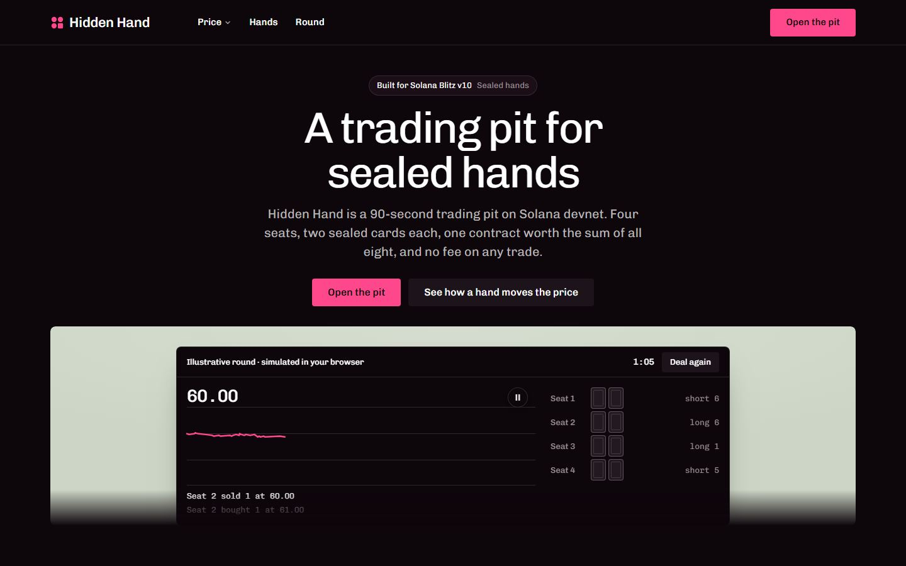

<!-- readme-schema: R1-web-app v1 -->
# Hidden Hand

A 90-second on-chain trading pit where four sealed hands set the price of their own hidden sum.

## Demo

https://youtu.be/bl4FznfYQj0

The video shows Express mode: an autoplay demo round with no wallet popup, where a script plays seat 4. The live app at `/app/` defaults to wallet mode (real wallet popups, one per trade); `/app/?mode=express` is Express mode.

Live site: [hiddenhand.suitz.xyz](https://hiddenhand.suitz.xyz) (the pit: [/app/](https://hiddenhand.suitz.xyz/app/); rounds run on Solana devnet)

On-chain proof: program [`HZdoTuj1N8u1EBsVB6Bd6cgXDVnswb1cX1nFkX4miRFb`](https://explorer.solana.com/address/HZdoTuj1N8u1EBsVB6Bd6cgXDVnswb1cX1nFkX4miRFb?cluster=devnet) on devnet; a base-layer [delegation transaction](https://explorer.solana.com/tx/2qB2YVU4HuebT9voJH3P6zjxaCqSmdqfE8DGtXbQUX8n68MPdD2M1dH5suHx9VW5tuCGzz5yWjjrL9qvgHNpVhoA?cluster=devnet) (`delegate_pda`, table) from the round in [docs/proof/devnet-round.md](docs/proof/devnet-round.md)



## What it does

Prediction-style games on a public chain usually fail at the one thing they need: nobody can hold a secret, so nobody can trade on private information. Hidden Hand deals each of four seats two sealed cards inside a MagicBlock Private Ephemeral Rollup, and everyone trades one contract worth the hidden sum of all eight cards against an on-chain market maker. It is a **linear information market**: one contract moves the price one point, so each trade's size encodes what a sealed hand knows, and the price converges on the hidden sum **by design**, not through clever bots. Trades on the Ephemeral Rollup are zero-fee. **Wallet mode** (the default at `/app/`) seats you with your own devnet wallet (any Solana wallet that supports the Wallet Standard: Phantom, Solflare, Backpack...): one wallet popup per trade, three bots in the other seats, and an in-tab house that opens, deals, settles and sweeps its leftover SOL back to you. **Express mode** (`/app/?mode=express`, or the link `demo-round` prints) is the no-wallet demo with a burner seat key and no prompt per trade; it is what the demo video shows. At the bell the hands flip public, the round settles, and the best trader takes the pot on the base layer. Scripted bots fill empty seats.

## Quickstart

```
pnpm install
pnpm --filter @hidden-hand/web dev
```

The web app needs the design kit at `~/.claude/skills/design-taste-frontend/`; it is copied in at build time and never committed.

With a funded devnet burner in the git-ignored `.env` as `HH_BURNER_KEYPAIR_JSON`, run one round and open the link it prints:

```
pnpm --filter @hidden-hand/bots demo-round -- --demo
```

The runner prints `/app/?round=<id>`; open that on the running web app to spectate, take the free seat, and trade with the hand hint.

Or open `/app/` with a devnet wallet and press **Open a table**: one round needs about 0.09 devnet SOL (the app shows the exact amount before you sign), and the leftover comes back to the wallet at the end.

## Built at Solana Blitz v10 (Entertainment Finance)

Host: MagicBlock. Deadline: 2026-11-27 14:00 UTC. Portal categories: Games · DeFi · Privacy. Solo builder with an AI build pipeline. Everything in this repo was built during the event.

## How it works

### The round

1. `open_table`, then four players `join_table` on Solana devnet (0.01 devnet SOL per seat). The table and the four hands are delegated to the Private Ephemeral Rollup.
2. **The deal.** A MagicBlock VRF request is served inside the Private ER (TEE) on `DEFAULT_EPHEMERAL_QUEUE`. Each seat gets two cards; the hidden sum is the sum of all eight (8 to 120, mean 64).
3. **Sealed hands.** Each Hand is an ephemeral permission private to its owner (member flags `AUTHORITY | TX_LOGS | TX_BALANCES | TX_MESSAGE | ACCOUNT_SIGNATURES`). The owner reads their hand through an auth-token TEE connection; a stranger reads `null`. This is what ships; the proof is in [`docs/spike/spike-result.md`](docs/spike/spike-result.md) and [`docs/proof/devnet-round.md`](docs/proof/devnet-round.md).
4. **Trades.** Zero-fee trades on the ER against the linear-impact market maker: open price 64.00, 1 contract moves the price 1.00, lots of 1 to 5, position cap of 15 either way.
5. **The bell.** `reveal_hands` flips every hand public, `settle_round` computes the P&L, and the round commits and undelegates back to Solana.
6. **Claim.** The best P&L (ties go to the lowest seat) takes the pot with `claim_pot` on the base layer.

A real round on devnet in the default `tee` mode, with every base-layer and ER signature, is recorded in [`docs/proof/devnet-round.md`](docs/proof/devnet-round.md).

### Why the price converges

The hidden sum is a sum of private signals, so a seat's information is worth exactly its hand minus 16 points. A bot (or a human following the on-screen hint) holds the position `own - 16`, which moves the price by exactly what that hand knows. Monte Carlo on the exact engine and policy code, 2000 seeded deals per row:

| case | close within 4 of the hidden sum |
|---|---|
| 4 bots | 100 % |
| seat 4 = random trader | 35 % |
| seat 4 = idle human | 51.1 % |

**A random or idle human breaks the reveal, which is why `--demo` fills seat 4 with a bot.** A human who follows the on-screen hint behaves like a bot and keeps the close within 4.

### Wallet mode

Wallet mode is what `/app/` opens with no parameters; `/app/?mode=express` and the runner's `/app/?round=<id>` link open Express mode instead. Sealed hands run on the MagicBlock Private ER (TEE) in both modes.

- **Popups, in order:** one transfer that funds the round, one to take your seat, one sign-in message for the Private ER token, then one wallet popup per trade.
- **Keys:** the house and the three bot keys are generated in the tab, live in memory and `sessionStorage` only, and are swept back to your wallet when the round ends. A wallet round leaves about 0.001 SOL of rent in your seat account and the table's house-paid rent; neither is reclaimed in v1.
- **The preview warning:** your wallet previews a Rollup trade against Solana, where the table is locked to the Rollup, so it may warn that the transaction could fail. That is expected; the app sends the trade to the Private ER, where it runs.
- **The reveal:** you hold one seat and three bots fill the rest. A random or idle human breaks the reveal; following the hint keeps the close within 4.
- **Evidence:** [docs/proof/wallet-round.md](docs/proof/wallet-round.md) records one devnet wallet-mode round on the TEE: 4 wallet popups (fund 1, join 1, sign-in 1, trades 1), one wallet trade on the Rollup, a signature delayed 8 s that still landed, about 0.033 SOL spent net of the sweep. The wallet there is a Wallet Standard mock backed by a keypair, driven from a Node script; it is not a session of a real browser wallet (Phantom, Solflare, Backpack or any other Wallet Standard wallet).
- **Wallet compatibility (tested on devnet, 2026-11-27 and 2026-11-28):** Solflare: connect, funding, join and sign-in work; Rollup trades are blocked by the wallet ("Network mismatch"). OKX: blocked at the first popup. Phantom: full round works on devnet (connect, funding, join, sign-in, Rollup trades, reveal). Any Solana wallet is listed in the app, but trades may not work in every wallet. A closed or blocked popup shows an in-app message, and the bots finish the round.
- **What is proven:** two things: the mock-wallet round above ([docs/proof/wallet-round.md](docs/proof/wallet-round.md)), and the manual tests recorded in [docs/gates/wallet-manual-test.md](docs/gates/wallet-manual-test.md). With Phantom (2026-11-28, devnet) a full round ran on the Private ER: connect, funding, join, sign-in, three trades each signed in its own popup, reveal and sweep. With Solflare (2026-11-27) the round reached the Private ER but the wallet blocked the first trade; OKX was blocked at the first popup. For wallets that block Rollup trades, the planned fix is a session-key variant, so the wallet signs once per round, not once per trade.

### The commit-reveal fallback

The same program also carries a **commit-reveal over VRF** deal path as a switchable fallback (`callback_deal_cr` and `reveal_secret`, on the public devnet ER). It is what we planned to ship if the Private ER read had failed; it did not, so the Private ER (TEE) path is the default. The fallback seals hands with a VRF seed plus committed secrets instead of a TEE permission. Switch to it with `--mode commit-reveal` on the runner, `HH_DEAL_MODE=commit-reveal` in the environment, or `?mode=commit-reveal` on the web app (see Run locally).

## Tech stack

- Anchor 1.0.2, Agave 3.1.9, Rust 1.89.0
- `ephemeral-rollups-sdk` 0.18.0 (Private ER permissions, VRF, commit/undelegate), TS SDK 0.18.0
- React 18 + Vite
- Scripted TypeScript bots (no LLM agents, no off-chain game server)

## Run locally

Build the program (this builds in WSL on the Linux filesystem):

```
wsl -d Ubuntu-24.04 -u root --exec bash -l program/scripts/wsl-build.sh
```

Run the TypeScript tests:

```
pnpm --filter @hidden-hand/client verify
pnpm --filter @hidden-hand/bots verify
```

Run a round (`--demo` fills seat 4 with a bot; add `--proof` to write `docs/proof/devnet-round.md`):

```
pnpm --filter @hidden-hand/bots demo-round -- [--demo] [--proof] [--seat4 <pubkey>] [--duration <secs>] [--mode tee|commit-reveal]
```

### Deal mode

The default is the Private ER (`tee`). To use the commit-reveal fallback, pass `--mode commit-reveal` to the runner, or set `HH_DEAL_MODE=commit-reveal`; a CLI `--mode` wins over the env var. The web app takes `/app/?round=<id>&mode=commit-reveal`.

### Environment variables

| name | purpose |
|---|---|
| `HH_BURNER_KEYPAIR_JSON` | Devnet burner keypair JSON. Keep it in the git-ignored `.env` or a user env var; never commit it. |
| `HH_DEAL_MODE` | `tee` (default) or `commit-reveal`; selects the deal path. |

### Operator notes

After any program redeploy, wait at least 5 minutes before running a round. The ER validators keep serving the previous cached program for a few minutes (we saw `ModeNotSupported` 6006 from a stale devnet-as about 30 seconds after an upgrade). The runner retries the first `request_deal` with backoff for up to about 6 minutes and logs "ER has not refreshed the program yet".

## Contract addresses

| network | address | explorer |
|---|---|---|
| devnet | `HZdoTuj1N8u1EBsVB6Bd6cgXDVnswb1cX1nFkX4miRFb` | [explorer](https://explorer.solana.com/address/HZdoTuj1N8u1EBsVB6Bd6cgXDVnswb1cX1nFkX4miRFb?cluster=devnet) |

## Roadmap

Known limits:

- Devnet only, no real funds.
- Unaudited.
- One table at a time.

Stretch goals not built: a private-payments cash-out, and a crank that rings the bell.

## License

MIT, see [`LICENSE`](LICENSE).
